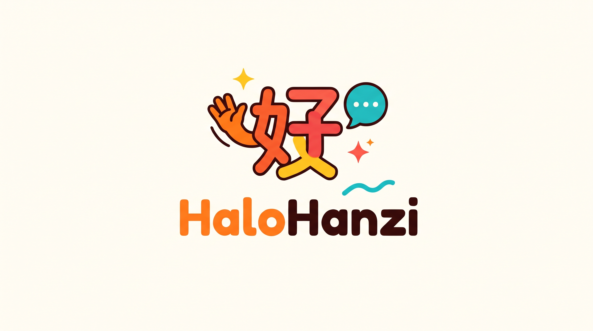

<p align="center">
  
</p>

<h1 align="center">HaloHanzi</h1>

<p align="center">
  <strong>An intuitive, story-driven Mandarin Chinese learning application for Android, built with Jetpack Compose, Kotlin, and native Android speech synthesis.</strong>
</p>

<p align="center">
  <a href="https://developer.android.com"></a>
  <a href="https://kotlinlang.org"></a>
  <a href="https://developer.android.com/jetpack/compose"></a>
</p>

---

## Overview

**HaloHanzi** is designed around comprehensible input and contextual immersion. Instead of relying solely on isolated flashcards or rote memorization, HaloHanzi introduces learners to practical vocabulary and grammar patterns through bite-sized lessons, interactive drills, and graded readers.

Every graded story is built with a controlled vocabulary corresponding strictly to the learner's current proficiency level (HSK 1 through HSK 2+), allowing beginners to read continuous passages comfortably with interactive support.

---

## Key Features

### 1. Interactive Graded Readers
- **Controlled Vocabulary Stories:** Contextual narratives crafted specifically to reinforce recently acquired words.
- **Tap-to-Translate (Instant Dictionary):** Tap any Hanzi character or compound word to open an immediate modal definition complete with Pinyin, tonal marks, contextual usage notes, native pronunciation playback, and a bookmark shortcut.
- **Pinyin Toggle:** Seamlessly switch between Hanzi with Ruby Pinyin annotations and pure character reading to build character recognition.
- **Karaoke Audio Narration:** Follow along sentence by sentence with synchronized text highlighting and auto-scrolling powered by Android's native Text-to-Speech engine.
- **Reading Comprehension Quizzes:** Multiple-choice questions at the end of each story evaluate comprehension and retention with instant explanations.

### 2. Structured Micro-Lessons
- **Grammar Essentials:** Concise, digestible breakdowns of sentence order, negation rules, and question patterns.
- **Interactive Sentence Builder:** Construct natural Mandarin sentences using interactive draggable word blocks with Pinyin and Hanzi.
- **Listening & Comprehension:** Audio-based comprehension exercises to train your ear for native conversational rhythms.

### 3. Offline Native Text-to-Speech (TTS)
- Directly integrated with Android's system speech engine (`Locale.SIMPLIFIED_CHINESE`).
- Runs locally and offline without external API keys or recurring cloud fees.
- Configurable learner-friendly playback speeds (0.7x Slow, 0.85x Natural).

### 4. Personal Vocabulary Bank
- One-tap bookmarking from any story or lesson.
- Review and practice word pronunciation in a centralized repository anytime.

---

## Architecture & Tech Stack

```
com.example.chineselearning/
├── audio/
│   └── TtsManager.kt               # Native Android Text-to-Speech wrapper
├── data/
│   ├── model/
│   │   └── Models.kt               # Word, Sentence, Story, Lesson data structures
│   └── repository/
│       └── LearningRepository.kt   # HSK curriculum, dictionary, and graded stories
├── ui/
│   ├── components/
│   │   ├── KaraokeSentenceCard.kt  # Sentence container with karaoke highlight
│   │   └── WordDetailDialog.kt     # Tap-to-translate modal dialog
│   ├── screens/
│   │   ├── HomeScreen.kt           # Course units & learning roadmap
│   │   ├── StoryListScreen.kt      # Graded reader library
│   │   ├── StoryReaderScreen.kt    # Interactive reading environment
│   │   ├── LessonExerciseScreen.kt # Interactive exercises (sentence builder, listening)
│   │   ├── SavedVocabScreen.kt     # Personal vocabulary review
│   │   └── MainAppContainer.kt     # Bottom navigation & screen orchestrator
│   └── theme/
│       ├── Color.kt                # Application color tokens
│       ├── Theme.kt                # Material3 light & dark scheme
│       └── Type.kt                 # Typography definitions
└── MainActivity.kt                 # Single Activity entry point
```

- **UI Framework:** Jetpack Compose (Material3)
- **Language:** Kotlin 2.2+ (Kotlin DSL build scripts)
- **Minimum SDK:** API 24 (Android 7.0 Nougat) — covers 99.2% of active Android devices
- **Target SDK:** API 36 (Android 15 / 16)
- **Build System:** Gradle 9.4 with Version Catalogs (`libs.versions.toml`)

---

## Getting Started

### Prerequisites
- **Android Studio:** Ladybug / Meerkat / Quail or later.
- **JDK:** Version 17 or Version 21 (bundled with Android Studio JBR).
- **Android SDK:** Platform 35 / 36 and Build-Tools 36.1.0+.

### Installation & Build

1. Clone the repository:
   ```bash
   git clone https://github.com/FidelCristopher/halohanzi.git
   cd halohanzi
   ```

2. Open the project folder in **Android Studio**.

3. Let Android Studio sync the Gradle project files.

4. Build the debug APK via Gradle:
   ```bash
   ./gradlew assembleDebug
   ```
   *(On Windows Command Prompt, use `gradlew.bat assembleDebug`)*

5. Run on a connected physical device or Android Virtual Device (AVD):
   ```bash
   ./gradlew installDebug
   ```
   Or click the **Run 'app'** (Green Play button) in Android Studio.

---

## Curriculum & Graded Stories Outline

### Featured Graded Readers (Tab Cerita)
| Story | Chinese Title | Level | Category | Key Vocabulary & Patterns |
| :--- | :--- | :--- | :--- | :--- |
| **I Didn't Laugh** | 《我没笑》 | HSK 1 | Humor & School | 学校, 回家, 怎么样, 告诉, 掉进水里, 大笑, 只有, 没笑 |
| **Dad's Work** | 《爸爸的工作》 | HSK 1 | Humor & Family | 老师, 五岁, 小女孩, 你的爸爸, 做什么的, 妈妈让他做什么他就做什么 |
| **Who I Am** | 《我是谁》 | HSK 1 | Profile & Careers | 李大卫, 美国人, 在日本长大, 在英国上大学, 在中国工作, 英语老师 |
| **Do You Know Them?** | 《你认识他们吗？》 | HSK 1 | Family & Teachers | 认识, 两个人, 中文老师, 姓王, 英文老师, 姓李, 漂亮, 旅游, 跑步, 很高, 女儿, 儿子 |
| **You Have Grown Up** | 《你长大了》 | HSK 1 | Humor & Family | 孩子, 经常, 要钱, 买东西, 五毛钱, 已经, 长大了, 昨天, 今天, 明天, 大孩子, 五块钱 |
| **New Classmate Li Hua** | 《新同学李华》 | HSK 1 | Greetings & School | 你好, 我叫, 学生, 老师, 中国人, 认识, 高兴, 再见 |
| **David's Sunday** | 《大卫的星期天》 | HSK 1 | Time & Daily Life | 星期天, 二十岁, 上午八点三十分, 起床, 中午十二点, 看朋友 |
| **David's Family & Kitten** | 《大卫的家与小猫》 | HSK 1 | Family & Pets | 爸爸, 妈妈, 家, 喜欢, 小猫, 漂亮, 水果, 喝茶 |

### Curriculum Road
| Unit | Title | Level | Core Themes | Graded Reader Story |
| :--- | :--- | :--- | :--- | :--- |
| **Unit 1** | Membuat Teman Baru | HSK 1 | SVO word order, copula 是, negation 不是, question 吗 | 《新同学李华》, 《我没笑》, 《爸爸的工作》, 《我是谁》, 《你认识他们吗？》, 《你长大了》 |
| **Unit 2** | Jam & Jadwal Harian | HSK 1+ | Tanggal, umur, jam, menit, rutinitas | 《大卫的星期天》 |
| **Unit 3** | Keluarga & Rumah | HSK 1+ | Anggota keluarga, hewan peliharaan, makanan/minuman | 《大卫的家与小猫》 |

---

## Contributing

Contributions, feedback, and content expansions are welcome!
1. Fork the Project.
2. Create your Feature Branch (`git checkout -b feature/NewStory`).
3. Commit your Changes (`git commit -m 'Add new HSK 2 graded story'`).
4. Push to the Branch (`git push origin feature/NewStory`).
5. Open a Pull Request.
